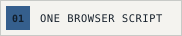
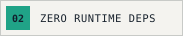
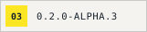
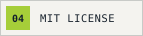
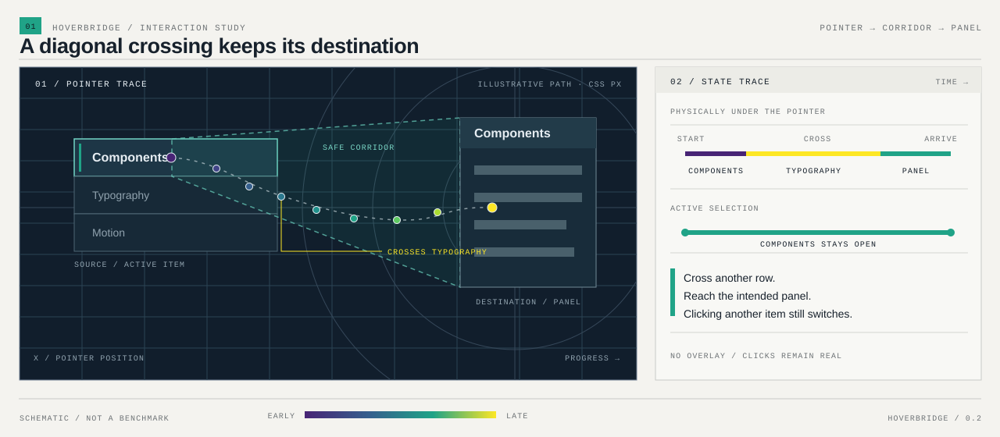
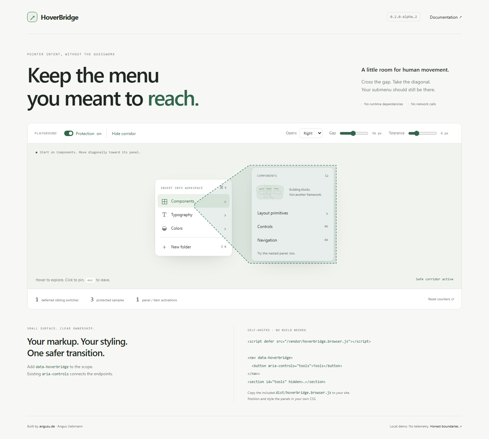

<p align="center"></p>

<h1 align="center">Das Untermenü, das du erreichen wolltest.<br>Bleibt erreichbar.</h1>
<p align="center">Über die Lücke. Quer durch die Liste.<br>Ohne versehentlich das nächste Menü zu öffnen.</p>

<p align="center">
  <a href="https://github.com/IamAngusU/HoverBridge/releases/download/v0.2.0-alpha.3/hoverbridge.browser.js"></a>
  
  <a href="https://github.com/IamAngusU/HoverBridge/releases/tag/v0.2.0-alpha.3"></a>
  <a href="LICENSE"></a>
  <a href="https://github.com/IamAngusU/HoverBridge/actions/workflows/ci.yml"></a>
</p>
<p align="center"><a href="#einmal-einbinden">Start</a> · <a href="#ausprobieren">Playground</a> · <a href="docs/api.md">API</a> · <a href="docs/testing.md">Messwerte</a> · <a href="README.md">English</a></p>

HoverBridge hält das aktive Panel offen, während sich der Pointer in seine Richtung bewegt. Auch dann, wenn der Weg über andere Listeneinträge oder einen leeren Abstand führt. Ein bewusster Richtungswechsel, Verweilen über einem anderen Eintrag oder ein Klick gibt die Auswahl wieder frei.

**Kein unsichtbares Overlay, das Klicks abfängt. Kein globales `pointer-events: none`. Kein neues Menü-Framework.**



<sub>Schematische Darstellung im Stil der Bloom-Grafiken. Der Weg ist ein Beispiel, keine Messung echter Nutzer.</sub>

## Einmal einbinden

Lade **[die versionierte Browser-Datei](https://github.com/IamAngusU/HoverBridge/releases/download/v0.2.0-alpha.3/hoverbridge.browser.js)** in die statischen Dateien deiner Website:

```html
<script defer src="/vendor/hoverbridge.browser.js"></script>
```

Markiere die Gruppe, deren Verhalten HoverBridge übernehmen darf. Bestehende `aria-controls`- oder `popovertarget`-Beziehungen verbinden Auslöser und Panel:

```html
<nav data-hoverbridge>
  <button type="button" aria-controls="tools" aria-expanded="false">Tools</button>
  <button type="button" aria-controls="export" aria-expanded="false">Export</button>
</nav>
<section id="tools" hidden>Deine Tools</section>
<section id="export" hidden>Exportoptionen</section>
```

Der Webserver liefert nur die Datei aus. Die Entscheidung läuft vollständig im Browser. Kein zusätzlicher Dienst, kein Konto und keine Laufzeit-Abhängigkeiten.

[Download und Prüfsumme](docs/install.md).

Die Standardwerte funktionieren ohne Konfiguration. Bei Bedarf stellst du nur die betreffenden Werte direkt am Menü ein:

```html
<nav data-hoverbridge data-hoverbridge-buffer="10" data-hoverbridge-close-delay="160">
  <!-- Auslöser mit aria-controls oder popovertarget -->
</nav>
```

`buffer` ist die Toleranz des Korridors in CSS-Pixeln; `close-delay` ist die Schließverzögerung in Millisekunden. Zusätzlich gibt es `data-hoverbridge-rest-ms` und `data-hoverbridge-open-delay`. Die Werte werden beim Anlegen des Bereichs gelesen. [Alle Optionen](docs/api.md#options).

**Positionierung und Gestaltung bleiben bei deiner Anwendung.** Markiere aktive Einträge über den verwalteten Zustand:

```css
[hidden] { display: none !important; }
.menu-item[data-hoverbridge-active] { background: var(--active); }
.menu-item:hover:not([data-hoverbridge-blocked]) { outline: 1px solid var(--hover); }
```

Ein unbedingtes CSS-`:hover` bleibt unter dem tatsächlichen Pointer aktiv. JavaScript kann diese Pseudoklasse nicht wegzaubern. Deshalb liefert HoverBridge Zustandsattribute, statt deine Styles oder fremde Event-Handler stillschweigend zu überschreiben. [Integration in bestehende Komponenten](docs/integration.md).

> [!NOTE]
> **0.2.0-alpha.3** ist ein GitHub-Prerelease mit versionierten Dateien und Prüfsummen. Das Paket liegt noch nicht in der npm-Registry; für Anwendungen mit Build-Schritt gibt es das [Release-Archiv](docs/install.md#application-with-a-build-step).

## Ausprobieren

Öffne **`demo/index.html`** im entpackten Ordner. Alle Dateien sind lokal; die Demo benötigt keinen Module-Server. Für Browser, die lokale Seiten einschränken, gibt es einen optionalen Preview-Server:

```sh
node scripts/serve.mjs
```

Danach `http://127.0.0.1:4173/demo/` öffnen. Node.js 20+ wird nur für diesen optionalen Server und die Entwicklung benötigt. Die originale Demo und der HTML-Einzelexport wurden zusätzlich per `file:` direkt in Chrome geöffnet und durchgespielt. [Testbericht](docs/testing.md).

<picture><source media="(prefers-color-scheme: dark)" srcset="docs/assets/playground-dark.png"></picture>
<sub>Browseraufnahme der beiliegenden Demo. [Aufnahmemethode und Testgrenzen](docs/testing.md#demo-evidence).</sub>

Die Demo bietet Schutz an/aus, einen sichtbaren Korridor, einstellbaren Abstand, vier Öffnungsrichtungen und ein verschachteltes Portal-Panel. Mauswege, bewusste Klicks, Escape und Tastaturfokus lassen sich direkt vergleichen.

Die Zähler zeigen tatsächliche lokale Aktivität. Sie erfinden keine Anzahl „verhinderter Bedienfehler“ und keine Zeitersparnis.

## In bestehende Anwendungen integrieren

Nach Installation des gepinnten [Release-Archivs](docs/install.md#application-with-a-build-step):

```ts
import { createHoverBridge } from '@iamangusu/hoverbridge';

const bridge = createHoverBridge(menuElement, {
  buffer: 10,
  closeDelay: 160,
});

bridge.setOptions({ buffer: 14 }); // im Betrieb anpassen
// Beim Entfernen der Komponente:
bridge.destroy();
```

Für genau einen Auslöser und ein Panel genügt `connectHoverBridge(trigger, panel)` ohne Markup-Änderung. Dynamische Menüs lassen sich mit `bridge.setItems(items)` aktualisieren. Wenn deine Komponente Öffnen und Schließen bereits selbst steuert, beobachtet `createHoverBridgeGuard(trigger, panel)` nur die Pointer-Absicht und verändert weder Sichtbarkeit noch Attribute. [API](docs/api.md) · [Integrationswege](docs/integration.md).

```ts
import { createHoverBridgeGuard } from '@iamangusu/hoverbridge/guard';

const guard = createHoverBridgeGuard(trigger, panel, {
  onChange({ hold }) {
    if (!hold) reconsiderClosing(); // Die Entscheidung bleibt bei deiner Komponente.
  },
});

// Nach dem Sichtbarwerden des Panels:
guard.refresh();
// Beim Entfernen der Komponente:
guard.destroy();
```

## Lokale Messwerte

`bridge.metrics` enthält Zähler für Pointer-Samples, geschützte Samples, zurückgestellte Wechsel, Öffnen, Schließen und Layout-Lesevorgänge. `bridge.resetMetrics()` beginnt einen neuen Beobachtungszeitraum. Die Bibliothek sendet und speichert keine Telemetrie. Ein zurückgestellter Wechsel beweist keinen Bedienfehler. [Genaue Bedeutung der Zähler](docs/api.md#metrics).

Für Maintainer schreibt `npm run metrics` Bundle-Größe und einen Microbenchmark des DOM-freien Kerns nach `docs/evidence/`. Die CI lädt diese Dateien pro Linux-Lauf als Artefakt hoch. Browser-Layout und Rendering sind in diesen Zeiten nicht enthalten. [Messbereich](docs/testing.md#size-and-core-benchmark).

## Verhalten

| Fall | Umsetzung |
| --- | --- |
| Diagonale Wege über Nachbarzeilen | Auswahlwechsel werden im gültigen Korridor zurückgestellt. |
| Abstand, versetzte oder umgeklappte Panels | Aktuelle Rechtecke statt fest angenommener Öffnungsrichtung. |
| Verweilen oder bewusstes Wegbewegen | Freigabe über Ruhezeit, Rückbewegung und maximale Übergangsdauer. |
| Verschachtelte Portal-Panels | Aktive Nachfolger halten ihre Eltern offen. |
| Maus, Pen-Hover und Touch | Geometrie für Maus und schwebenden Stift, normale Klick-/Tap-Bedienung für Touch. |
| Fokus und Escape | Fokus hält offen; Escape schließt zuerst die tiefste aktive Ebene. Kein Fokus-Trap. |
| Dynamischer Inhalt und Aufräumen | Erkennung markierter Bereiche, `setItems()`, `setOptions()`, sichere Mehrfachinitialisierung und Wiederherstellung eigener DOM-Änderungen. |

## Grenzen

HoverBridge ist kein automatischer Patch für beliebige Radix-, React- oder andere Zustandsautomaten. Es ersetzt weder CSS-`:hover` noch Positionierung, vollständige ARIA-Menüsteuerung oder echte modale Dialoge. Iframes und native Betriebssystem-Menüs werden nicht überbrückt. Open Shadow DOM wird explizit registriert; Closed Shadow DOM benötigt einen Adapter innerhalb der Komponente.

Der Geometrie-Kern lässt sich in andere Laufzeiten übertragen. Fertige native Adapter sind in dieser Version nicht enthalten.

| Browserfamilie | Lokale Prüfung |
| --- | --- |
| Chrome und Edge | Je 61 Interaktionstests im installierten Windows-Browser bestanden. |
| Firefox | 61 Tests in Playwright Firefox bestanden. |
| Safaris WebKit-Engine | 61 Tests in Playwright WebKit unter Windows bestanden; Safari auf Apple-Hardware ist noch ungetestet. |

Physische Stift- und Touch-Geräte sind ebenfalls noch ungetestet. [Browsermatrix und Grenzen](docs/testing.md).

## Projektbefehle

```sh
npm ci                    # Entwicklungswerkzeuge installieren
npm run browsers:install  # Chromium, Firefox und WebKit installieren
npm run check             # Build, Unit-Tests und Browsermatrix
npm run metrics           # Größe und Core-Microbenchmark messen
npm run demo              # Vorschau: http://127.0.0.1:4173/demo/
```

Für die Script-Einbindung auf deiner Website brauchst du keinen dieser Befehle. `npm run test:browsers` prüft die ganze lokale Engine-Matrix; `npm run test:browser` prüft eine Engine. [Einzelbrowser und installierte Browser testen](docs/testing.md).

[Messwerte und Tests](docs/testing.md) · [Architektur](docs/architecture.md) · [Deployment](docs/deployment.md) · [Mitarbeiten](CONTRIBUTING.md) · [Sicherheit](SECURITY.md)

<p align="center"><sub>Powered by <a href="https://angusu.de">angusu.de</a> · Angus Uelsmann · <a href="LICENSE">MIT</a></sub></p>
