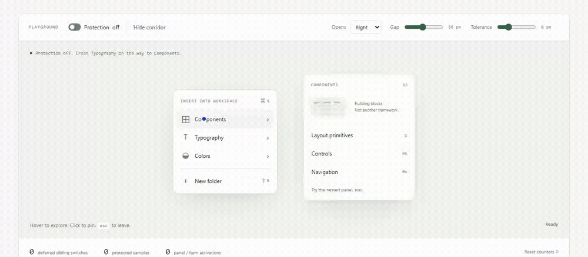

<p align="center"></p>

<h1 align="center">Keep the menu you meant to reach.</h1>
<p align="center">Cross the gap. Take the diagonal.<br>Your submenu should still be there.</p>

<p align="center"><a href="README.de.md"></a></p>

<p align="center">
  <a href="https://github.com/IamAngusU/HoverBridge/releases/tag/v0.2.0-alpha.3"></a>
  <a href="docs/install.md"></a>
  <a href="LICENSE"></a>
</p>

<p align="center"><a href="#quick-start">Start</a> · <a href="#try-it">Playground</a> · <a href="docs/api.md">API</a> · <a href="docs/testing.md">Measured behavior</a> · <a href="README.de.md">Deutsch</a></p>

A submenu should not be an obstacle course. HoverBridge keeps the active panel open while the pointer heads toward it, including through empty space and across neighboring rows. Move somewhere else deliberately, stop over another item, or click it: the interface follows your choice.

**No invisible click-catching overlay. No global `pointer-events: none`. No replacement menu framework.**

**For existing websites and custom menu components.** [Try the live demo](https://angusu.de/hoverbridge/index.html) · [Install guide](docs/install.md)



<sub>Ten seconds, the same scripted pointer path: protection off, then on. Real browser capture of the included playground; not a user study.</sub>

## Quick start

```sh
npm install https://github.com/IamAngusU/HoverBridge/releases/download/v0.2.0-alpha.3/iamangusu-hoverbridge-0.2.0-alpha.3.tgz
```
```js
import { createHoverBridge } from '@iamangusu/hoverbridge';
const menu = document.querySelector('[data-hoverbridge]');
if (menu) createHoverBridge(menu);
```

The versioned release archive works today; registry publication is pending account setup. Without a build step, use the browser file below.

## Paste once

Download **[the versioned browser file](https://github.com/IamAngusU/HoverBridge/releases/download/v0.2.0-alpha.3/hoverbridge.browser.js)** into your site's static assets, then load it:

```html
<script defer src="/vendor/hoverbridge.browser.js"></script>
```

Mark the group you want HoverBridge to own. Existing `aria-controls` or `popovertarget` relationships connect triggers to panels:

```html
<nav data-hoverbridge>
  <button type="button" aria-controls="tools" aria-expanded="false">Tools</button>
  <button type="button" aria-controls="export" aria-expanded="false">Export</button>
</nav>

<section id="tools" hidden>Your tools</section>
<section id="export" hidden>Export options</section>
```

That is the integration, not a build step. No Node.js, package manager, account or server process is needed on the visitor's device. Your ordinary web server serves the script. All pointer decisions stay in the browser. [Download and checksum instructions](docs/install.md).

The defaults work without configuration. When a menu needs tuning, add only the values you want to change to its scope:

```html
<nav data-hoverbridge data-hoverbridge-buffer="10" data-hoverbridge-close-delay="160">
  <!-- triggers with aria-controls or popovertarget -->
</nav>
```

`buffer` is the corridor tolerance in CSS pixels; `close-delay` is the leave grace in milliseconds. The two other markup options are `data-hoverbridge-rest-ms` and `data-hoverbridge-open-delay`. They are read when a scope is created. [All options](docs/api.md#options).

**Keep your positioning and styling.** Use the managed active state for row highlights:

```css
[hidden] { display: none !important; }
.menu-item[data-hoverbridge-active] { background: var(--active); }
.menu-item:hover:not([data-hoverbridge-blocked]) { outline: 1px solid var(--hover); }
```

The second rule is optional. Unconditional CSS `:hover` still matches the element physically under the pointer; JavaScript cannot cancel that pseudo-class. HoverBridge prevents its own state switches and supplies markers for your styles. It does not silently override somebody else's hover handlers. [Existing components and CSS](docs/integration.md).

> [!NOTE]
> **0.2.0-alpha.3** is a GitHub prerelease with versioned, checksummed assets. It is not published to the npm registry; use the [release archive](docs/install.md#application-with-a-build-step) for a build-step application.

## Try it

Open **`demo/index.html`** from the extracted folder. It uses ordinary relative scripts and local CSS, not a module server. Browsers or managed environments that restrict local pages can use the included preview instead:

```sh
node scripts/serve.mjs
```

Open `http://127.0.0.1:4173/demo/`. Node.js 20+ is only needed for this optional preview and development. Direct `file:` navigation was also exercised in Chrome on Windows. [Exact evidence](docs/testing.md).

<picture>
  <source media="(prefers-color-scheme: dark)" srcset="docs/assets/playground-dark.png">
  
</picture>
<sub>Browser capture of the included demo, with corridor debugging enabled. [Capture method and limits](docs/testing.md#demo-evidence).</sub>

Toggle protection to compare normal hover behavior, show the actual corridor, adjust the gap, change the opening side, and enter the nested portal panel. Try a deliberate sibling click while the corridor is active. It remains a real click.

The counters are local to this page: samples protected, sibling switches deferred, items activated. They do **not** claim to measure user mistakes or time saved.

## More control, same core

For applications with a build step, install the pinned [release archive](docs/install.md#application-with-a-build-step), then import the side-effect-free entry:

```ts
import { createHoverBridge } from '@iamangusu/hoverbridge';

const bridge = createHoverBridge(menuElement, {
  buffer: 10,
  closeDelay: 160,
});

bridge.setOptions({ buffer: 14 }); // live tuning, no rebuild
// When this component unmounts:
bridge.destroy();
```

For one existing trigger and panel, `connectHoverBridge(trigger, panel)` needs no markup changes. For dynamic menus, `bridge.setItems(items)` replaces bindings without rebuilding the controller. If your component already controls opening and closing, `createHoverBridgeGuard(trigger, panel)` observes pointer intent without writing attributes or visibility. [API and options](docs/api.md) · [Integration recipes](docs/integration.md).

```ts
import { createHoverBridgeGuard } from '@iamangusu/hoverbridge/guard';

const guard = createHoverBridgeGuard(trigger, panel, {
  onChange({ hold }) {
    if (!hold) reconsiderClosing(); // Your component keeps ownership.
  },
});

// After your component makes the panel visible:
guard.refresh();
// During unmount:
guard.destroy();
```

## Local metrics

`bridge.metrics` exposes in-memory counters for pointer samples, protected samples, deferred sibling switches, opens, closes and layout reads. `bridge.resetMetrics()` starts a fresh observation window. No telemetry is sent or stored. A deferred switch is a decision made by the controller, not proof that a user would have made a mistake. [Exact counter meanings](docs/api.md#metrics).

For maintainers, `npm run metrics` records bundle size and a DOM-free core microbenchmark in `docs/evidence/`. CI uploads those files for each Linux run. These timings exclude browser layout and rendering. [Measurement scope](docs/testing.md#size-and-core-benchmark).

[Build evidence and source provenance](docs/deployment.md#ci-and-evidence).

## What it handles

| Situation | Behavior |
| --- | --- |
| Diagonal path through neighboring rows | Defers sibling activation while movement remains in the safe corridor. |
| Empty gap, offset or flipped panel | Uses current viewport rectangles, not a hard-coded right-facing triangle. |
| Pointer pauses or changes direction | Releases on rest, a deliberate retreat or the hard transit limit. |
| Nested, same-document portal panels | Active descendants keep their parent panels open. |
| Mouse, hovering pen, touch | Pointer intent for mouse and pen hover; ordinary click/tap handling for touch. |
| Keyboard focus, Escape, outside click | Focus persistence, deepest-first Escape, click-to-pin and ordinary dismissal. No focus trap. |
| Dynamic content and teardown | Explicit-scope discovery, `setItems()`, `setOptions()`, mutation handling, idempotent setup and reversible managed attributes. |

## What it does not pretend to do

It is not a universal patch for every framework's private state machine. It does not cancel CSS `:hover`, position panels, build a complete ARIA menu, manage true modal dialogs, cross iframe boundaries, or control native OS menus. Open Shadow DOM needs an explicit registration; closed roots need an adapter inside the component.

The geometric core is portable. Native adapters are **not** shipped in this version.

| Browser family | Verification |
| --- | --- |
| Chrome and Edge | 61 interaction tests passed in each installed Windows browser. |
| Firefox | 61 passed locally and in the Windows, Linux and macOS CI mirror. |
| WebKit | 61 passed locally and in the Windows, Linux and macOS CI mirror; the Safari application itself remains untested. |

Physical pen/touch devices remain untested. [Browser matrix and boundaries](docs/testing.md).

## Why not Floating UI or Radix?

[Floating UI](https://floating-ui.com/docs/usehover#safepolygon) already provides `safePolygon()` and positioning. If your application uses it, try its hover interaction first. [Radix](https://www.radix-ui.com/primitives/docs/components/dropdown-menu) supplies complete React primitives with their own state and keyboard behavior.

Choose HoverBridge for existing HTML, another framework, or your own menu when you need a small pointer-intent layer. Its guard entry leaves state ownership with your component. It does not supply positioning or a complete accessible menu. Avoid putting competing visibility controllers on the same panel.

## Project commands

```sh
npm ci                    # install development tools
npm run browsers:install  # install Chromium, Firefox and WebKit for local tests
npm run check             # build, unit tests and browser matrix
npm run metrics           # measured size and core benchmark
npm run demo              # preview at http://127.0.0.1:4173/demo/
```

The script-only integration above needs none of these commands on your website. `npm run test:browsers` runs the full local engine matrix; `npm run test:browser` runs one engine. [Single-engine and installed-browser instructions](docs/testing.md).

[Measured sizes, timings and test logs](docs/testing.md) · [How the corridor works](docs/architecture.md) · [Deploy](docs/deployment.md) · [Contribute](CONTRIBUTING.md) · [Security](SECURITY.md)

<p align="center"><sub>Powered by <a href="https://angusu.de">angusu.de</a> · Angus Uelsmann · <a href="LICENSE">MIT</a></sub></p>

<p align="center"><a href="https://github.com/IamAngusU/icon-marquee"></a></p>
